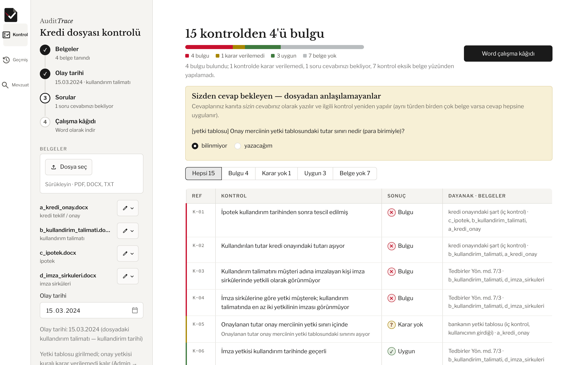
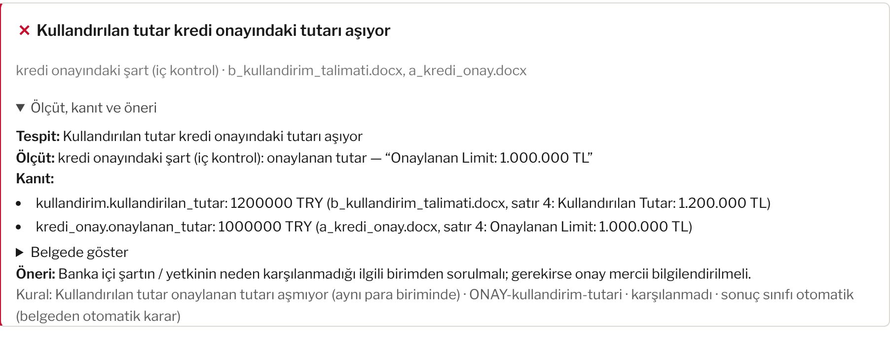

# AuditTrace

[](https://github.com/SalihEfe00/AuditTrace/actions/workflows/ci.yml)

Banka şubesi kredi dosyaları ve teminat belgeleri için kurallı kontrol aracı. Belgeleri okur, belirlenimci
kurallarla denetler ve her bulguyu ölçüt, belgeden alıntılanan kanıt ve öneriyle verir. Tamamen yerel çalışır;
belgeler bilgisayardan çıkmaz.

> Kişisel portföy ve öğrenme projesidir; bir banka ürünü değildir. Kuralların hukuki gözden geçirmesi
> yapılmamıştır. Depodaki tüm örnek belgeler ve kişi, kimlik, IBAN bilgileri uydurmadır.

*English: AuditTrace is a local, rule-based checker for bank-branch credit files and collateral documents
(Turkish legislation). Every finding comes with its criterion, a verbatim quote from the document and a
recommendation. Personal portfolio project, not a bank product.*



## Hemen deneyin

Mevzuat kütüphanesi, Tesseract ya da dil modeli gerekmez. Örnek kredi dosyası (uydurma bilgili 4 belge: kredi
onayı, kullandırım talimatı, ipotek, imza sirküleri) arayüzsüz kontrol edilir ve bulgular terminale yazılır:

```bash
pip install -r requirements.txt
python app.py --demo
```

Aynı dosya arayüzde `streamlit run app.py` → **Örnek dosyayla dene** ile açılır. Her bulgu, dayanağı ve belgedeki
satırıyla gelir:



## Neler yapar

- **Kural kontrolü:** 43 kural, 7 belge türü (kredi onayı, kullandırım talimatı, ipotek, kefalet sözleşmesi,
  imza sirküleri vb.). Her kontrolün sonucu: bulgu, uygun, karar verilemedi ya da eksik belge yüzünden yapılamadı.
- **Kanıt:** Bulgunun ölçütü (mevzuat maddesi ya da iç kontrol şartı) ve belgedeki satırıyla birebir alıntı.
- **Sorular:** Belgeden anlaşılamayan bilgi tahmin edilmez, müfettişe sorulur; cevap kanıta "müfettiş beyanı"
  olarak yazılır ve ilgili kontrol yeniden çalışır.
- **OCR:** Taranmış PDF'ler Tesseract ile yerelde okunur; okunan metin düzeltilebilir.
- **Mevzuat yardımcısı:** Şikâyet ve not metinlerindeki iddiaları 836 belgelik yerel mevzuat kütüphanesinde
  arar (anlam benzerliği + yeniden sıralama). İsteğe bağlı yerel dil modeli (Ollama) yalnızca zayıf
  eşleşmeleri reddedebilir, kendi başına bulgu üretmez.
- **Çıktı:** Word çalışma kâğıdı; geçmiş kararlar denetim izinde.

## Kurulum (kaynaktan)

Python 3.12, Windows üzerinde test edildi.

```bash
python -m venv .venv
.venv\Scripts\activate
pip install -r requirements.txt
streamlit run app.py
```

- Tam ortam: `requirements-lock.txt`. İsteğe bağlı özellikler: `requirements-optional.txt`.
- OCR için sistemde Tesseract (Türkçe dil paketiyle) kurulu olmalıdır.
- Mevzuat kütüphanesi (`data/`, ~1 GB) depoda yoktur; mevzuat yardımcısı ve mevzuat araması için Admin →
  "İlk mevzuat kurulumu" ile resmî kaynaklardan kurulur (internet gerekir).
- Yerel dil modeli isteğe bağlıdır: [Ollama](https://ollama.com) ve `qwen2.5:7b`.

Windows kurulum paketi `packaging/` altındaki betiklerle üretilir (PyInstaller + ONNX Runtime); ayrıntı
[docs/architecture/packaging.md](docs/architecture/packaging.md).

## Testler

```bash
pytest
```

## Klasörler

| Klasör | İçerik |
|---|---|
| `mufettis/` | Uygulama: belge okuma, alan çıkarma, kurallar, mevzuat arama, arayüz |
| `mufettis/repair/` | Mevzuat kütüphanesinin bakım ve onarım hattı (tarama, aday onarım, doğrulama, geri alma); yalnızca Admin ve CLI |
| `mufettis/rules/catalog/` | Kural kataloğu (JSON) |
| `tests/` | Birim ve uçtan uca testler |
| `benchmarks/` | Sentetik vakalar ve ölçüm betikleri |
| `scripts/` | Mevzuat derleme, envanter ve bakım betikleri |
| `packaging/` | Windows paketi ve kurulum |
| `docs/` | Kapsam, plan ve mimari kararlar |

## In English

AuditTrace checks the documents of a bank-branch credit file (credit approval, drawdown instruction, mortgage
deed, guarantee contract, signature circular, …) against Turkish legislation and internal control requirements.
It is a personal portfolio project, not a bank product; all sample documents and personal data in the repository
are synthetic.

### How it works

```
document (PDF, scanned PDF, DOCX, DOC, HTML, TXT)
  → text extraction       pypdfium2 + quality gate; Tesseract OCR for scanned pages (local)
  → document type         deterministic title / body signals
  → field extraction      labelled fields, each one of three states: filled (value + line) / empty / not found
  → rule engine           43 rules in a JSON catalogue (mufettis/rules/catalog/)
  → findings              criterion (article or internal requirement) + verbatim quote + recommendation
  → inspector questions   what the document cannot answer is asked, never guessed
  → Word working paper    decisions kept in an audit trail
```

### Design decisions

- **Missing evidence is never "met".** A rule passes only on positive evidence. An empty field (label present,
  value blank) and a field that was not found at all (OCR may have missed it) are different: the first can be a
  finding, the second makes the result *undecided*.
- **Unrecognised input stays unknown.** A value the parser cannot read with certainty ("Evli değil", an amount in
  a non-Turkish number format) becomes *undecided* and is asked to the inspector instead of being turned into a
  plausible but wrong value.
- **Every finding is traceable.** Each rule carries its legal basis with the quoted article text, the exceptions
  and the rationale; each result carries the document line it was read from. Inspector answers are recorded as
  "inspector statement" evidence and the rule is re-evaluated.
- **Rules apply by date.** A rule is evaluated against the text of the law in force on the event date.
- **The language model cannot create findings.** The legislation assistant searches a local library of 836
  regulations (embedding similarity + lexical search + re-ranking). An optional local LLM (Ollama) may only
  *reject* weak matches.
- **Everything runs locally.** Documents never leave the machine.

### Quick start

```bash
pip install -r requirements.txt
python app.py --demo     # checks the sample credit file in the terminal; no legislation library needed
streamlit run app.py     # UI; "Örnek dosyayla dene" opens the same sample file
pytest
```

Tests that need the legislation library (`data/`, not in the repository), Tesseract or Windows are skipped when
those are absent.

## Lisans

[MIT](LICENSE). Pakete giren üçüncü taraf bileşenlerin lisans bildirimleri `packaging/notices.py` ile üretilir;
yazı tipleri (Libre Franklin, Libre Baskerville) SIL Open Font License altındadır (`static/fonts/`).
